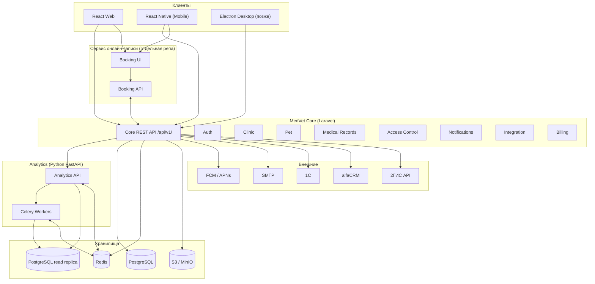
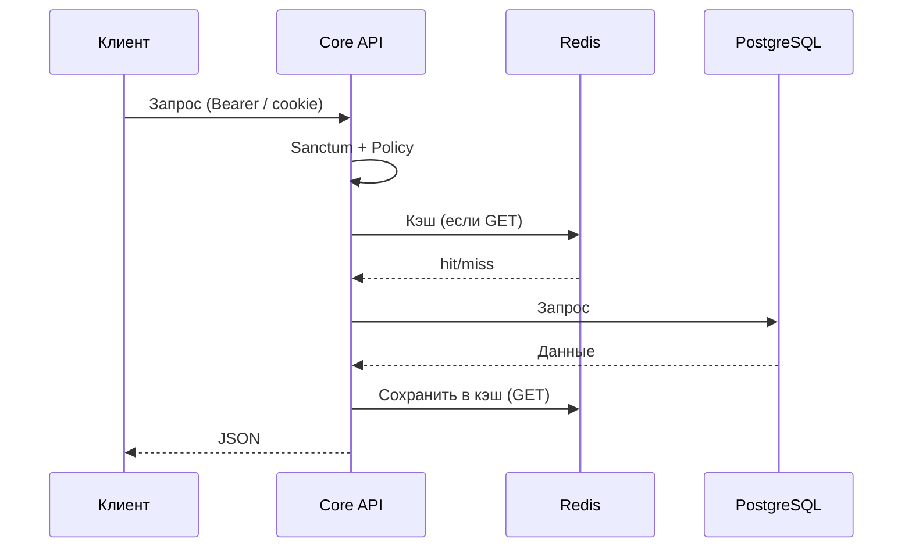

# Схема сервисов

Как устроены сервисы, кто с кем общается и как это раздаётся по контейнерам.

---

## Общая схема

---

## Модули ядра (Laravel)

| Модуль | Зона ответственности |
|--------|----------------------|
| Auth | Регистрация, логин, токены (Sanctum → Passport), refresh |
| Clinic | Клиники, точки, врачи, кабинеты, расписание, 2ГИС |
| Pet | Питомцы, владельцы (физлица и компании) |
| Medical Records | Прививки, дегельминтизация, обработка от клещей, история болезней, рецепты |
| Access Control | Выдача/отзыв доступа к питомцу (PetAccess), пермишены |
| Notifications | Напоминания (прививка, глистогонка, запись), push/email |
| Integration | Адаптеры 1С, alfaCRM, очереди синхронизации |
| Billing | Тарифы, подписки |

---

## Аналитика (Python)

| Уровень | Что считает |
|---------|-------------|
| Питомец | Динамика веса, температуры, частота болезней |
| Клиника | Нагрузка врачей, диагнозы, приёмы, доходы |
| B2B | Заболеваемость поголовья, прогнозы, аномалии |

Чтение только из read replica. Тяжёлые задачи — Celery. Результаты в Redis. В Фазе 0 сервис не поднимаем.

---

## Поток запроса к Core

---

## Инфраструктура

**Nginx** — единственная точка входа. SSL здесь. Маршрутизация:

| Путь | Сервис |
|------|--------|
| `/api/v1/*` | Core (Laravel) |
| `/analytics/*` | Analytics (Python) |
| `/booking/*` | Booking |

**Docker.** Контейнеры: `nginx`, `core` (Laravel), `analytics` (Python + Celery), `postgres`, `redis`, `minio`. Всё в одной внутренней сети; снаружи только Nginx (80/443). Сервисы общаются по имени контейнера, отдельные API-ключи между собой не нужны.

**Фаза 0:** поднимаем только Core + PostgreSQL + Redis + Minio + Nginx. Analytics и Booking — когда появятся в фазах.
