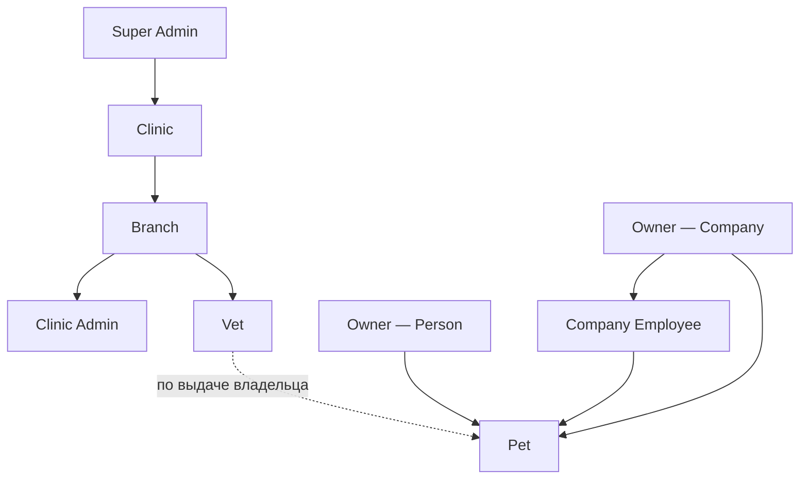

# Роли и доступы

Кто что может делать. Реализация: `spatie/laravel-permission` + Laravel Policies.

---

## Иерархия ролей

---

## Роли — кратко

| Роль | Возможности |
|------|--------------|
| Super Admin | Модерация клиник, список пользователей, редактирование, бан, создание |
| Clinic | Точки, подписка, аналитика по клинике |
| Branch | Сущность: адрес, часы, кабинеты, врачи |
| Clinic Admin | Расписание, врачи, клиенты точки, записи |
| Vet | Питомцы только по выданному доступу; приём, история, прививки, рецепты |
| Owner — Person | Питомцы, выдача/отзыв доступа, напоминания, поиск клиник |
| Owner — Company | То же + сотрудники, аналитика |
| Company Employee | Доступ к животным компании (права задаёт Admin) |

---

## Регистрация клиники

Клиника регистрируется сама (данные + документы). Статус `pending`. Суперадмин проверяет документы и одобряет или отклоняет. До активации функции заблокированы.

---

## Врач и точка

Врач регистрируется сам. Клиника отправляет инвайт по email. Если врача нет в системе — уходит письмо с ссылкой на регистрацию; после регистрации ему показывается запрос от клиники. Врач принимает или отклоняет → создаётся запись в `vet_branches` (vet_id, branch_id, position, active_from, active_to).

---

## Доступ к питомцу (PetAccess)

Доступ на уровне питомца: владелец может выдать доступ к одному питомцу и не выдавать к другому.

**Таблица `pet_access`:** pet_id, granted_to_id (врач/семья), granted_by_id (владелец), branch_id (в контексте какой точки), access_type (vet | family), expires_at, revoked_at.

**Проверка в Policy:** один запрос `exists()` по pet_id, user_id, revoked_at IS NULL, (expires_at IS NULL OR expires_at > now()). Без подгрузки списка доступов.

**При записи через Booking:** сервис записей вызывает Core → создаётся PetAccess с expires_at = дата приёма + N часов. Walk-in: врач запрашивает доступ → владелец получает пуш и подтверждает/отклоняет.

**Уход врача из точки:** при проставлении `active_to` в vet_branches автоматически отзываем его PetAccess по этой branch_id. История болезней, которую он вёл, не удаляется.

---

## Сценарии визита

| Сценарий | Как данные попадают в систему |
|----------|-------------------------------|
| Запись онлайн | Booking создаёт PetAccess → врач видит питомца; владелец может отозвать позже |
| Walk-in, владелец с приложением | Врач запрашивает доступ → пуш владельцу → подтверждение → PetAccess |
| Walk-in, владелец без приложения | Клиника вводит телефон/email. Есть аккаунт — уведомление; нет — создаём pending, шлём ссылку «скачайте приложение». Визит сохраняем; после регистрации владелец видит данные |
| Клиника не в системе | Владелец сам вносит визит (ручное заполнение) или загружает фото документа |

У каждой медзаписи поле **source:** `vet_system` | `owner_reported` | `ocr_auto` | `imported`. Верификация записей «добавлено владельцем» врачом — после MVP. OCR (распознавание фото выписки) — после MVP; в модели поле уже есть.

---

## B2B: компания и сотрудники

Company Admin — полный доступ к животным и сотрудникам. Company Employee — доступ к животным компании; гранулярные права (только часть животных) — после MVP. Мелкий заводчик — один аккаунт (Admin без сотрудников).

---

## Пермишены (ориентир)

**Pets:** pet.view.own, pet.view.granted, pet.view.company, pet.view.all, pet.create, pet.edit.own, pet.delete.own  
**Medical:** medical.view.granted, medical.create, medical.edit.own_record, medical.edit.all  
**Clinic:** clinic.manage, clinic.register, branch.manage, vet.invite_to_branch  
**Access:** pet.access.grant, pet.access.revoke  
**Company:** company.manage, company.employee.manage  

Детализировать при разработке.
